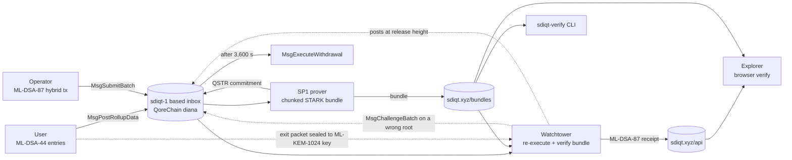

# SDIQT

SDIQT gives every batch of a QoreChain qledger rollup a hash-based STARK proof that anyone can check in a browser. On the diana testnet, 4 of 4 batches of the rollup `sdiqt-1` are proven and final, and a 2 QOR withdrawal was paid from a proven batch.

**Live:** https://sdiqt.xyz · **Video:** _placeholder, the link is added at submission_ · **Evidence:** [PROOF.md](PROOF.md)

Numbers in this README come from [PROOF.md](PROOF.md) and [`docs/counts.json`](docs/counts.json), a snapshot at diana height 10728225 that `scripts/proof.mjs` recomputes from chain.

## The problem

A qledger-v1 rollup on QoreChain is optimistic. A batch settles when its 3,600 s challenge window closes without an upheld fraud proof, and the chain re-executes a batch only inside a challenge. After that the node prunes posted data and drops finalized batch records after 432,000 blocks, so an outsider who arrives later has to rebuild the whole inbox to know that a batch was executed correctly.

The validity proofs already on QoreChain are pairing-based SNARKs, which a large quantum computer breaks. SDIQT adds a proof built only from hashes, about 1.27 MB per chunk, that a browser checks in milliseconds.

## How it works

1. **Users post entries.** Deposits, transfers and withdrawals go into the rollup's based inbox with `MsgPostRollupData`. Transfers and withdrawals carry an ML-DSA-44 signature by the user's qledger key.
2. **The operator anchors a batch.** It batches the inbox in based order and sends `MsgSubmitBatch`, hybrid signed with the ML-DSA-87 key it registered on chain, backed by a 1,000 QOR submitter bond.
3. **The prover makes a STARK.** SP1 re-executes qledger-v1 for the batch, checks every ML-DSA-44 signature inside the proof, and writes a bundle: linked chunk proofs of up to 4 signed entries each plus a manifest. The bundle is served at `https://sdiqt.xyz/bundles`.
4. **The operator commits to the bundle.** A QSTR record of about 300 bytes goes into the same inbox. It names the batch, its roots, the program's verifying key, the proof root and the SHA-256 of the manifest. Its first byte makes it a no-op for qledger, so it never changes rollup state ([spec](specs/qstr-v1.md)).
5. **The watchtower checks and signs.** A separate account re-executes each batch with the RDK fraud check, verifies the bundle against the chain's roots and issues a settlement receipt signed by its registered ML-DSA-87 key. A batch with a wrong root gets `MsgChallengeBatch`.
6. **Anyone verifies.** The explorer verifies the bundle in the browser (WebAssembly) and has a Flip One Byte button that shows the same check failing. The `sdiqt-verify` CLI does the same from a clone.
7. **Users exit.** After the window closes, `MsgExecuteWithdrawal` pays the withdrawal from the deposit pool with its Merkle path. A user who expects to be offline can seal a signed withdrawal to the watchtower's ML-KEM-1024 key with QoreSeal; the tower posts it at the chosen height ([spec](specs/exit-packet-v1.md)).



## Trust model

| Party | What it can do | What stops it |
|---|---|---|
| Operator | Submits batches and QSTR records | Its 1,000 QOR bond: anyone can challenge a wrong root within 3,600 s. User transfers need the user's ML-DSA-44 signature, checked by qledger and inside the proof. |
| Prover | Produces bundles | A bad bundle fails `sdiqt-verify` and the watchtower's check. A missing prover leaves batches unproven; settlement goes on. |
| Watchtower | Signs receipts, challenges wrong roots, holds sealed exit packets until their release height | Every receipt field is re-derivable from chain data and the bundle. The tower has no key over rollup funds and no submitter bond. A user can always post a withdrawal directly. |
| Explorer | Shows chain data and verifies bundles in the browser | Chain data in the browser is relayed by sdiqt.xyz; the CLI and `scripts/proof.mjs` read the chain directly. |
| QoreChain | Settles every batch by its challenge window | The STARK is checked off chain by the watchtower, the browser and the CLI. Settlement stays optimistic. |

The full analysis is in [THREAT_MODEL.md](THREAT_MODEL.md); known gaps are in [LIMITS.md](LIMITS.md).

## How it's made

The stack is Rust for the proof (SP1 6.10.0, a qledger-v1 port in `crates/qledger-core`, the verifier in `crates/sdiqt-verify`) and TypeScript for the operator, watchtower, archiver and React explorer.

QoreChain's RDK carries the rollup: `MsgCreateRollup`, `MsgSubmitBatch`, `MsgPostRollupData`, `MsgChallengeBatch` and `MsgExecuteWithdrawal`. The PQC module holds the ML-DSA-87 keys of the operator, the watchtower and the demo user (`MsgRegisterPQCKeyV2`) and the watchtower's ML-KEM-1024 key (`MsgRegisterKEMKey`). QoreSeal seals exit packets to that key.

The hardest part was memory. A 4-entry chunk proves in 145 to 192 s using about 10.3 to 10.8 GB on a 16 GB Apple M5; an 11-entry chunk fails during compression. The prover therefore splits a batch into chunks of at most 4 signed entries and 6.1M cycles, and each chunk starts from the root and inbox accumulator where the previous one ended, so the verifier links the chunks into one continuous execution from the batch's parent root. A 64-entry batch becomes 16 chunks, about 45 to 48 minutes on one machine by projection, inside the 3,300 s proof deadline ([calibration](docs/prover-calibration.md)).

The guest must agree with the chain byte for byte. The golden RDK vectors run in CI, and a real batch of `rdk-v328-e2e-mwd5v89d`, a rollup run by another team, is in the repo: 5 entries, VALID, with the same roots as its chain record (tx `FACE91C06DA7…`, height 10195236).

A chunk proof is about 1.27 MB and verifies in 30 to 62 ms.

## Built on QoreChain

| Primitive | What it does here | Code |
|---|---|---|
| RDK qledger-v1 rollup, based sequencing | Rollup `sdiqt-1`, inbox, batches, fraud path | [`apps/operator/src/submit.ts`](apps/operator/src/submit.ts), [`crates/qledger-core`](crates/qledger-core) |
| `checkQledgerFraud` (`@qorechain/rdk`) | Watchtower re-execution of every batch | [`apps/watchtower/src`](apps/watchtower/src) |
| `MsgChallengeBatch` | Challenge of a wrong-root batch | [`apps/watchtower/src/challenge.ts`](apps/watchtower/src/challenge.ts) |
| `MsgExecuteWithdrawal` | Withdrawal paid from a final batch | [`apps/operator/src/withdraw.ts`](apps/operator/src/withdraw.ts) |
| ML-DSA-87 PQC keys, hybrid signed txs | Operator txs and watchtower receipts | [`packages/chain/src/operator-key.ts`](packages/chain/src/operator-key.ts), [`apps/watchtower/src/receipt.ts`](apps/watchtower/src/receipt.ts) |
| `MsgRegisterKEMKey`, ML-KEM-1024 | Recipient key of sealed exit packets | [`apps/operator/src/accounts.ts`](apps/operator/src/accounts.ts) |
| QoreSeal (`@qorechain/qoreseal`) | Seals and opens exit packets | [`apps/operator/src/exit-packet.ts`](apps/operator/src/exit-packet.ts), [`apps/watchtower/src/exits.ts`](apps/watchtower/src/exits.ts) |

## Deployments

Chain `qorechain-diana` (testnet), rollup `sdiqt-1`, SP1 program verifying key hash `db524751acbbee71eeddae759b6ef92513fe787d8f88585c5d3e38252be32065`.

| Account | Address |
|---|---|
| Operator (rollup creator, bonded submitter) | `qor17fhcxn83a0l9lqs8dmyesp5xeqdxsphu0j87x3` |
| Watchtower (receipt signer, ML-KEM recipient) | `qor1uelq3hzhnt6q6g7qts2uhscwct6l87yu48zczh` |
| Demo user | `qor1lk7fdflxvyxes9tudqzgkm65uss2pf5ehh6q63` |
| Project address | `qor1al5y6d68tcxnfvfnejpfaxfuy7cdyqrs9gyavc` |

Every setup transaction, with height and the check that ran on it, is in [PROOF.md](PROOF.md#setup-on-chain).

## Evidence

At height 10728225 ([PROOF.md](PROOF.md)):

| Count | Value |
|---|---|
| Batches submitted / proven / final | 4 / 4 / 4 |
| Batches rejected by a challenge | 0 |
| User entries (deposits / transfers / withdrawals) | 5 (2 / 2 / 1) |
| QSTR commitments posted | 4 |
| Setup and withdrawal claims checked against chain | 8 of 8 |
| Median time from batch submit to QSTR post | 17 min 13 s |
| Longest time from batch submit to QSTR post | 18 min 49 s |

Batches 0 to 2 waited in the prove queue for a fix; batch 3 went from submit to QSTR in 2 min 8 s. The withdrawal: the demo user posted a signed 2 QOR withdrawal in batch 3 (tx `18EE89B6…`), and after batch 3 was final `MsgExecuteWithdrawal` paid it (tx `D4E2A450…`, height 10728212).

Built and tested, with the on-chain run still to come (listed under "Not shown yet" in PROOF.md):

- **Watchtower challenge:** a staged wrong-root batch challenged by the watchtower, the bond slashed, the receipt VOID.
- **ML-KEM exit packet:** an offline user's sealed withdrawal opened by the watchtower at its release height and posted to the inbox. The exit desk runs on the live watchtower.

Attack cases and their refusals are in [`redteam/`](redteam/). Formats are specified in [`specs/`](specs/).

## Quick start

Needs Rust (stable) and, for the last part, Node.js 22.18 or later with pnpm.

Verify a real batch of another team's rollup from the repo:

```bash
git clone https://github.com/youvandra/sdiqt && cd sdiqt
cargo install --locked --path crates/sdiqt-verify
sdiqt-verify bundle vectors/bundles/rdk-v328-e2e/batch-1-FACE91C06DA7
```

```text
VALID in 82.2ms
  chain qorechain-diana rollup rdk-v328-e2e-mwd5v89d batch 1
  inbox 4..9 in 2 chunk(s), signatures full
  state_root       87e75c9b1402b1ebf3a01c73f9002daada5635e041740e18a24e5d61070d2e8b
  ...
```

Verify a live `sdiqt-1` batch with the program pinned (exit code 0 is VALID, 1 is INVALID):

```bash
mkdir batch-3 && cd batch-3
curl -sfO https://sdiqt.xyz/bundles/batch-3-FC48D936F9B4/manifest.json -O https://sdiqt.xyz/bundles/batch-3-FC48D936F9B4/chunk-0.bin
sdiqt-verify bundle . --vkey-hash db524751acbbee71eeddae759b6ef92513fe787d8f88585c5d3e38252be32065
```

The printed `manifest sha256` (`a22fd9bd…`) equals the one in batch 3's QSTR in PROOF.md.

Recompute PROOF.md from chain (from the repo root; `--check` fails if any number would change):

```bash
pnpm install --frozen-lockfile
node apps/archiver/src/cli.ts --rollup sdiqt-1 --from-height 10720040
node scripts/proof.mjs --bundles https://sdiqt.xyz/bundles --at-height 10728225 --check
```

```text
{"snapshot_height":"10728225","batches":4,"proven":4,"final":4,"claims_ok":"8/8","changed":0}
```

Tests: `pnpm test` for TypeScript and `cargo test` for Rust.

## Repository

| Path | Contents |
|---|---|
| [`crates/qledger-core`](crates/qledger-core) | qledger-v1 execution in Rust, derived from the RDK |
| [`crates/sdiqt-statement`](crates/sdiqt-statement) | Chunk statement, inputs and limits |
| [`crates/sdiqt-guest`](crates/sdiqt-guest), [`crates/sdiqt-prover`](crates/sdiqt-prover) | SP1 program and prover (needs the SP1 toolchain) |
| [`crates/sdiqt-verify`](crates/sdiqt-verify) | Verifier: CLI, library and WebAssembly build |
| [`apps/operator`](apps/operator) | Batching, proving queue, QSTR, withdrawals, exit packets |
| [`apps/watchtower`](apps/watchtower) | Re-execution, receipts, challenges, exit desk, API |
| [`apps/archiver`](apps/archiver) | JSONL archive of the inbox and batches that outlives chain pruning |
| [`apps/explorer`](apps/explorer) | The site at sdiqt.xyz |
| [`packages/protocol`](packages/protocol), [`packages/verify`](packages/verify), [`packages/chain`](packages/chain) | Shared formats, bundle checks, chain client with spend caps |
| [`specs/`](specs/), [`vectors/`](vectors/) | Format specs and test vectors |

## Prior art

- **Cloister** runs zk rollups on diana whose SNARK the chain checks at submit, on a custom VM. That gives instant finality with pairing-based cryptography. SDIQT proves the standard qledger-v1 path with a hash-based STARK that the chain leaves to off-chain checkers.
- **Vigil** and **Wicketgate** run qledger rollups with watchtowers that re-execute batches and sign ML-DSA attestations. SDIQT's watchtower does the same re-execution and adds a proof that a third party checks without re-executing.
- **RDK pull request #1** upstream adds a re-execution validator for qledger batches in several languages. SDIQT uses the RDK's own `checkQledgerFraud` for that step.

## Protocol Builders requirements

| Requirement | Where to see it |
|---|---|
| ML-DSA-signed batches | Operator ML-DSA-87 key registered (tx `4FAC7406…`), every batch hybrid signed; user entries ML-DSA-44, checked inside each STARK. [PROOF.md](PROOF.md) |
| Withdrawal | 2 QOR withdrawal posted in batch 3 and paid by `MsgExecuteWithdrawal` (tx `D4E2A450…`). [PROOF.md](PROOF.md#setup-on-chain) |
| Settlement receipt | Watchtower ML-DSA-87 key registered (tx `BDA2DF6F…`); receipts at `https://sdiqt.xyz/api/receipts/<batch>`, shown on each batch in the explorer |
| Watchtower | Re-executes and verifies every batch; challenge path in [`apps/watchtower/src/challenge.ts`](apps/watchtower/src/challenge.ts); on-chain challenge listed under "Not shown yet" |
| ML-KEM data protection | Watchtower ML-KEM-1024 key registered (tx `6FB680F1…`); exit packets sealed with QoreSeal ([spec](specs/exit-packet-v1.md)); on-chain exit listed under "Not shown yet" |
| Threat model | [THREAT_MODEL.md](THREAT_MODEL.md), [LIMITS.md](LIMITS.md) |

## Credits

- [QoreChain RDK](https://github.com/qorechain/qorechain-rdk) (`@qorechain/rdk` 0.9.0, Apache-2.0): rollup messages and fraud check; `crates/qledger-core` is derived from it (see [NOTICE](NOTICE)).
- [SP1](https://github.com/succinctlabs/sp1) by Succinct (6.10.0): zkVM, prover and `sp1-verifier`, with the SP1 SHA-256 and Keccak patches.
- [noble](https://paulmillr.com/noble/) (`@noble/post-quantum` 0.7.1, `@noble/hashes` 2.4.0): ML-DSA and hashing in TypeScript.
- QoreSeal (`@qorechain/qoreseal` 0.1.0): ML-KEM-1024 envelopes for exit packets.
- `@qorechain/sdk` and CosmJS: chain client and signing.

## AI use

Most code and documentation was written with Claude Code under the team's direction; design decisions, every on-chain spend and every merge were the team's. Details, and how the output was checked, are in [AI_USAGE.md](AI_USAGE.md).

## License

Apache-2.0. See [LICENSE](LICENSE) and [NOTICE](NOTICE).
