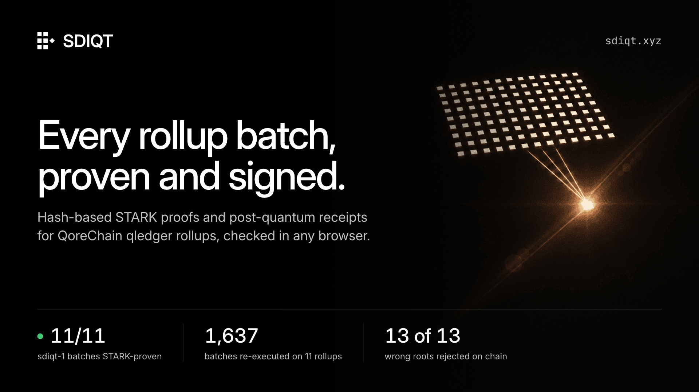
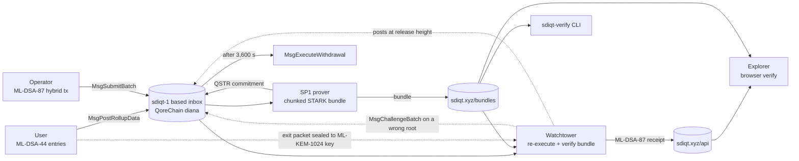

# SDIQT

[](https://build.qorechain.io/p/sdiqt)
[](https://github.com/youvandra/sdiqt/actions/workflows/verify.yml)
[](https://github.com/youvandra/sdiqt/actions/workflows/e2e.yml)
[](https://github.com/youvandra/sdiqt/actions/workflows/uptime.yml)
[](https://scorecard.dev/viewer/?uri=github.com/youvandra/sdiqt)
[](LICENSE)



SDIQT gives every batch of a QoreChain qledger rollup a hash-based STARK proof that anyone can check in a browser. On the diana testnet all 21 current `sdiqt-1` batches are proven, two withdrawals were paid, one through a sealed ML-KEM exit, and a wrong root we staged was rejected 7 s after it landed. The same watchtower re-executes every qledger-v1 rollup on diana: 11 rollups, 1,644 batches, 14 wrong roots found and all 14 rejected by QoreChain.

**Live:** https://sdiqt.xyz · **Video:** _placeholder, the link is added at submission_ · **Evidence:** [PROOF.md](PROOF.md)

The `sdiqt-1` evidence in this README comes from [PROOF.md](PROOF.md) and [`docs/counts.json`](docs/counts.json), a snapshot at diana height 10799151 (26 Nov 2026 16:46 UTC) that `scripts/proof.mjs` recomputes from chain. Coverage numbers come from [`/api/rollups`](https://sdiqt.xyz/api/rollups) as of 26 Nov 2026 16:46 UTC.

## The problem

A qledger-v1 rollup on QoreChain is optimistic. A batch settles when its 3,600 s challenge window closes without an upheld fraud proof, and the chain re-executes a batch only inside a challenge. After that the node prunes posted data and drops finalized batch records after 432,000 blocks, so an outsider who arrives later has to rebuild the whole inbox to know that a batch was executed correctly.

The validity proofs already on QoreChain are pairing-based SNARKs, which a large quantum computer breaks. SDIQT adds a proof built only from hashes, about 1.27 MB per chunk, that a browser checks in milliseconds.

## How it works

1. **Users post entries.** Deposits, transfers and withdrawals go into the rollup's based inbox with `MsgPostRollupData`. Transfers and withdrawals carry an ML-DSA-44 signature by the user's qledger key.
2. **The operator anchors a batch.** It batches the inbox in based order and sends `MsgSubmitBatch`, hybrid signed with the ML-DSA-87 key it registered on chain, backed by a 1,000 QOR submitter bond.
3. **The prover makes a STARK.** SP1 re-executes qledger-v1 for the batch, checks every ML-DSA-44 signature inside the proof, and writes a bundle: linked chunk proofs of up to 4 signed entries each plus a manifest. The bundle is served at `https://sdiqt.xyz/bundles`.
4. **The operator commits to the bundle.** A QSTR record of about 300 bytes goes into the same inbox. It names the batch, its roots, the program's verifying key, the proof root and the SHA-256 of the manifest. Its first byte makes it a no-op for qledger, so it never changes rollup state ([spec](specs/qstr-v1.md)).
5. **The watchtower checks and signs.** A separate account re-executes each batch with the RDK fraud check, verifies the bundle against the chain's roots and issues a settlement receipt signed by its registered ML-DSA-87 key. A batch with a wrong root gets `MsgChallengeBatch`.
6. **Anyone verifies.** The explorer verifies the bundle in the browser (WebAssembly) and has a Flip One Byte button that shows the same check failing. The `sdiqt-verify` CLI does the same from a clone.
7. **Users exit.** After the window closes, `MsgExecuteWithdrawal` pays the withdrawal from the deposit pool with its Merkle path. A user who expects to be offline can seal a signed withdrawal to the watchtower's ML-KEM-1024 key with QoreSeal; the tower posts it at the chosen height ([spec](specs/exit-packet-v1.md)).



## Every qledger rollup on diana

A qledger-v1 rollup with based sequencing posts every entry to a public inbox on QoreChain, so the watchtower re-executes it from chain data alone. Run with `--watch all`, the watchtower finds each such rollup on diana, keeps one watch-only tower per rollup in one process, and signs an ML-DSA-87 receipt for each batch with the same registered key it uses on `sdiqt-1`. Coverage has two tiers:

| Tier | Rollups | What each batch gets |
|---|---|---|
| STARK + re-execution | `sdiqt-1` | Re-execution, a STARK bundle named by a QSTR commitment, a signed receipt with both answers, and a fraud challenge on a wrong root |
| Re-execution | the other 10 | Re-execution against the roots the submitter claimed and a signed receipt; a wrong root is reported as a mismatch |

STARK proofs and challenges run on `sdiqt-1`; on the other rollups the watchtower re-executes and reports. The prover itself runs on any qledger-v1 batch: the `rdk-v328-e2e-mwd5v89d` batch in [Quick start](#quick-start) belongs to another team's rollup.

As of 26 Nov 2026 10:10 UTC, from [`/api/rollups`](https://sdiqt.xyz/api/rollups):

| Rollup | Tier | Batches checked | Re-execution match | Mismatching submissions | Rejected by QoreChain |
|---|---|---|---|---|---|
| `sdiqt-1` | STARK | 18 | 18 | 1 | 1 |
| `augury-oracle` | Re-execution | 0 | 0 | 0 | 0 |
| `ledgerpump` | Re-execution | 5 | 5 | 1 | 1 |
| `rdk-v328-e2e-mwd5v89d` | Re-execution | 7 | 7 | 2 | 2 |
| `sealed-scouts-1` | Re-execution | 1,521 | 1,521 | 2 | 2 |
| `skyproof-1` | Re-execution | 12 | 12 | 1 | 1 |
| `tree-rings` | Re-execution | 14 | 14 | 0 | 0 |
| `veil-pay-1` | Re-execution | 8 | 8 | 1 | 1 |
| `vigil-1` | Re-execution | 36 | 36 | 4 | 4 |
| `vigil-pay-1` | Re-execution | 23 | 23 | 2 | 2 |
| `wicketgate-pay` | Re-execution | 0 | 0 | 0 | 0 |
| **Total, 11 rollups** | | **1,644** | **1,644 (100%)** | **14** | **14** |

"Batches checked" counts the current submission at each batch index. Each of the 14 mismatching submissions claimed roots that differ from a re-execution of its inbox range; QoreChain rejected each one through an upheld fraud proof, and a later submission at the same index took its place, so the 1,654 submissions on record are the 1,640 current batches plus those 14. The `sdiqt-1` mismatch is the staged batch described under [Evidence](#evidence). On `sdiqt-1`, all 14 current batches are proven by a STARK; the median time from batch submit to QSTR post is 2 min 15 s ([PROOF.md](PROOF.md)).

The explorer lists every rollup at [sdiqt.xyz/rollups](https://sdiqt.xyz/rollups), with one page per rollup at `https://sdiqt.xyz/r/<rollup>`. The API serves each rollup at `/api/r/<rollup>/{health,batches,batches/<i>,receipts/<i>}`; `sdiqt-1` keeps its routes at `/api`.

## Trust model

| Party | What it can do | What stops it |
|---|---|---|
| Operator | Submits batches and QSTR records | Its 1,000 QOR bond: anyone can challenge a wrong root within 3,600 s. User transfers need the user's ML-DSA-44 signature, checked by qledger and inside the proof. |
| Prover | Produces bundles | A bad bundle fails `sdiqt-verify` and the watchtower's check. A missing prover leaves batches unproven; settlement goes on. |
| Watchtower | Signs receipts, challenges wrong roots on `sdiqt-1`, reports wrong roots on the other qledger-v1 rollups, holds sealed exit packets until their release height | Every receipt field is re-derivable from chain data and the bundle. The tower has no key over rollup funds and no submitter bond. A user can always post a withdrawal directly. |
| Explorer | Shows chain data and verifies bundles in the browser | Chain data in the browser is relayed by sdiqt.xyz; the CLI and `scripts/proof.mjs` read the chain directly. |
| QoreChain | Settles every batch by its challenge window | The STARK is checked off chain by the watchtower, the browser and the CLI. Settlement stays optimistic. |

The full analysis is in [THREAT_MODEL.md](THREAT_MODEL.md); known gaps are in [LIMITS.md](LIMITS.md).

## How it's made

The stack is Rust for the proof (SP1 6.10.0, a qledger-v1 port in `crates/qledger-core`, the verifier in `crates/sdiqt-verify`) and TypeScript for the operator, watchtower, archiver and React explorer.

QoreChain's RDK carries the rollup: `MsgCreateRollup`, `MsgSubmitBatch`, `MsgPostRollupData`, `MsgChallengeBatch` and `MsgExecuteWithdrawal`. The PQC module holds the ML-DSA-87 keys of the operator, the watchtower and the demo user (`MsgRegisterPQCKeyV2`) and the watchtower's ML-KEM-1024 key (`MsgRegisterKEMKey`). QoreSeal seals exit packets to that key.

The hardest part was memory. A 4-entry chunk proves in 145 to 192 s using about 10.3 to 10.8 GB on a 16 GB Apple M5; an 11-entry chunk fails during compression. The prover therefore splits a batch into chunks of at most 4 signed entries and 6.1M cycles, and each chunk starts from the root and inbox accumulator where the previous one ended, so the verifier links the chunks into one continuous execution from the batch's parent root. A 64-entry batch becomes 16 chunks. Calibration projected 45 to 48 minutes on an idle machine, inside the 3,300 s proof deadline. The first measured 64-entry batch (batch 19 of `sdiqt-1`) took 4,341 s (72 minutes) of proving on the shared 16 GB Mac, about 18 minutes past the deadline: other apps pushed each 10 GB chunk into swap, so chunks ran at 233 to 383 s (median 266 s). A late proof leaves settlement optimistic and the receipt reads unproven until the proof lands. A dedicated prover with 32 GB or more keeps 64-entry batches inside the deadline ([calibration](docs/prover-calibration.md)).

The guest must agree with the chain byte for byte. The golden RDK vectors run in CI, and a real batch of `rdk-v328-e2e-mwd5v89d`, a rollup run by another team, is in the repo: 5 entries, VALID, with the same roots as its chain record (tx `FACE91C06DA7…`, height 10195236).

A chunk proof is about 1.27 MB and verifies in 30 to 62 ms.

## Built on QoreChain

| Primitive | What it does here | Code |
|---|---|---|
| RDK qledger-v1 rollup, based sequencing | Rollup `sdiqt-1`, inbox, batches, fraud path | [`apps/operator/src/submit.ts`](apps/operator/src/submit.ts), [`crates/qledger-core`](crates/qledger-core) |
| `checkQledgerFraud` (`@qorechain/rdk`) | Watchtower re-execution of every batch, on `sdiqt-1` and on every other qledger-v1 rollup on diana | [`apps/watchtower/src`](apps/watchtower/src) |
| `MsgChallengeBatch` | Challenge of a wrong-root batch | [`apps/watchtower/src/challenge.ts`](apps/watchtower/src/challenge.ts) |
| `MsgExecuteWithdrawal` | Withdrawal paid from a final batch | [`apps/operator/src/withdraw.ts`](apps/operator/src/withdraw.ts) |
| ML-DSA-87 PQC keys, hybrid signed txs | Operator txs and watchtower receipts | [`packages/chain/src/operator-key.ts`](packages/chain/src/operator-key.ts), [`apps/watchtower/src/receipt.ts`](apps/watchtower/src/receipt.ts) |
| `MsgRegisterKEMKey`, ML-KEM-1024 | Recipient key of sealed exit packets | [`apps/operator/src/accounts.ts`](apps/operator/src/accounts.ts) |
| QoreSeal (`@qorechain/qoreseal`) | Seals and opens exit packets | [`apps/operator/src/exit-packet.ts`](apps/operator/src/exit-packet.ts), [`apps/watchtower/src/exits.ts`](apps/watchtower/src/exits.ts) |

## Deployments

Chain `qorechain-diana` (testnet), rollup `sdiqt-1`, SP1 program verifying key hash `db524751acbbee71eeddae759b6ef92513fe787d8f88585c5d3e38252be32065`.

| Account | Address |
|---|---|
| Operator (rollup creator, bonded submitter) | `qor17fhcxn83a0l9lqs8dmyesp5xeqdxsphu0j87x3` |
| Watchtower (receipt signer, ML-KEM recipient) | `qor1uelq3hzhnt6q6g7qts2uhscwct6l87yu48zczh` |
| Demo user | `qor1lk7fdflxvyxes9tudqzgkm65uss2pf5ehh6q63` |
| Project address | `qor1al5y6d68tcxnfvfnejpfaxfuy7cdyqrs9gyavc` |

Every setup transaction, with height and the check that ran on it, is in [PROOF.md](PROOF.md#setup-on-chain).

## Evidence

At height 10799151 ([PROOF.md](PROOF.md)):

| Count | Value |
|---|---|
| Batch submissions / current batches proven / final | 22 / 21 / 21 |
| Submissions rejected by a challenge | 1 (the staged batch 12) |
| User entries (deposits / transfers / withdrawals) | 84 (2 / 80 / 2) |
| QSTR commitments posted | 21 |
| Setup, withdrawal, exit and fraud claims checked against chain | 13 of 13 |
| Median time from batch submit to QSTR post | 2 min 18 s |
| Longest time from batch submit to QSTR post | 663 min 21 s |

Batches 3 to 8 and 10 to 18 went from submit to QSTR in 2 min 3 s to 5 min 13 s. Batches 0 to 2 waited in the prove queue for a fix. Batch 9 was submitted while the prover machine was shutting down; the saved job resumed on restart and proved it 663 min later, by which time the batch was already final. Batches 19 and 20 are the 64-entry load test: batch 19's 16 chunks proved on the shared Mac after a shutdown and restart and reached QSTR 225 min after submit, and batch 20 queued behind it (228 min); both were final before their proofs landed.

Two withdrawals were paid. The demo user posted a signed 2 QOR withdrawal in batch 3 (tx `18EE89B6…`), and after batch 3 was final `MsgExecuteWithdrawal` paid it (tx `D4E2A450…`, height 10728212). For the second, the demo user sealed a signed 2.5 QOR withdrawal to the watchtower's ML-KEM-1024 key with release height 10738199. The watchtower opened it at that height and posted it in batch 5 (tx `C451E059…`), and after batch 5 was final `MsgExecuteWithdrawal` paid it (tx `E9C47252…`, height 10779352).

The fraud path ran live on 26 Nov. With a typed confirmation, the operator submitted batch 12 with the last byte of its state root flipped (tx `B503A9D0…`, 10:01:45 UTC). An independent challenger sent a qledger fraud proof 7 s later (tx `A93FED3A…`). QoreChain re-executed the batch, rejected it, rolled the inbox back and slashed the operator's 1,000 QOR bond, burning 500 and paying 500 to the challenger. Our watchtower, polling every 30 s, then recorded the rejection with the state-root mismatch in its receipt. The operator bonded again (tx `9C21B756…`) and resubmitted batch 12 with the correct root, proven in 2 min 4 s.

Built and tested, with the on-chain run still to come (listed under "Not shown yet" in PROOF.md):

- **Our watchtower's own challenge:** the tower runs with `--challenge` and sends `MsgChallengeBatch` once its local `checkQledgerFraud` agrees ([`challenge.ts`](apps/watchtower/src/challenge.ts), [`redteam/`](redteam/)). In the staged run an independent challenger reached the chain first.

Attack cases and their refusals are in [`redteam/`](redteam/). Formats are specified in [`specs/`](specs/).

## Quick start

Needs Rust stable from [rustup](https://rustup.rs) (on macOS also the Xcode Command Line Tools: `xcode-select --install`) and, for the last part, Node.js 22.18 or later with pnpm. The CLI install compiles about 200 crates, about 36 s on a 10-core M-series Mac with the toolchain already in place. After every step below the clone, build output and package caches take about 1.1 GB of disk.

Verify a real batch of another team's rollup from the repo:

```bash
git clone https://github.com/youvandra/sdiqt && cd sdiqt
cargo install --locked --path crates/sdiqt-verify
sdiqt-verify bundle vectors/bundles/rdk-v328-e2e/batch-1-FACE91C06DA7
```

```text
VALID in 82.2ms
  chain qorechain-diana rollup rdk-v328-e2e-mwd5v89d batch 1
  inbox 4..9 in 2 chunk(s), signatures full
  state_root       87e75c9b1402b1ebf3a01c73f9002daada5635e041740e18a24e5d61070d2e8b
  ...
```

Verify a live `sdiqt-1` batch with the program pinned (exit code 0 is VALID, 1 is INVALID):

```bash
mkdir -p batch-3
curl -sf --output-dir batch-3 -O https://sdiqt.xyz/bundles/batch-3-FC48D936F9B4/manifest.json -O https://sdiqt.xyz/bundles/batch-3-FC48D936F9B4/chunk-0.bin
sdiqt-verify bundle batch-3 --vkey-hash db524751acbbee71eeddae759b6ef92513fe787d8f88585c5d3e38252be32065
```

The printed `manifest sha256` (`a22fd9bd…`) equals the one in batch 3's QSTR in PROOF.md.

Recompute PROOF.md from chain (from the repo root; `--check` fails if any number would change):

```bash
pnpm install --frozen-lockfile
node apps/archiver/src/cli.ts --rollup sdiqt-1 --from-height 10720040
node scripts/proof.mjs --bundles https://sdiqt.xyz/bundles --at-height 10853874 --check
```

```text
{"snapshot_height":"10853874","batches":22,"proven":21,"final":21,"claims_ok":"13/13","changed":0}
```

Tests: `pnpm test` for TypeScript and `cargo test` for Rust.

## Repository

| Path | Contents |
|---|---|
| [`crates/qledger-core`](crates/qledger-core) | qledger-v1 execution in Rust, derived from the RDK |
| [`crates/sdiqt-statement`](crates/sdiqt-statement) | Chunk statement, inputs and limits |
| [`crates/sdiqt-guest`](crates/sdiqt-guest), [`crates/sdiqt-prover`](crates/sdiqt-prover) | SP1 program and prover (needs the SP1 toolchain) |
| [`crates/sdiqt-verify`](crates/sdiqt-verify) | Verifier: CLI, library and WebAssembly build |
| [`apps/operator`](apps/operator) | Batching, proving queue, QSTR, withdrawals, exit packets |
| [`apps/watchtower`](apps/watchtower) | Re-execution, receipts, challenges, exit desk, API, watch-only towers for every qledger-v1 rollup |
| [`apps/archiver`](apps/archiver) | JSONL archive of the inbox and batches that outlives chain pruning |
| [`apps/explorer`](apps/explorer) | The site at sdiqt.xyz |
| [`packages/protocol`](packages/protocol), [`packages/verify`](packages/verify), [`packages/chain`](packages/chain) | Shared formats, bundle checks, chain client with spend caps |
| [`specs/`](specs/), [`vectors/`](vectors/) | Format specs and test vectors |

## Prior art

- **Cloister** runs zk rollups on diana whose SNARK the chain checks at submit, on a custom VM. That gives instant finality with pairing-based cryptography. SDIQT proves the standard qledger-v1 path with a hash-based STARK that the chain leaves to off-chain checkers.
- **Vigil** and **Wicketgate** run qledger rollups with watchtowers that re-execute batches and sign ML-DSA attestations. SDIQT's watchtower does the same re-execution and adds a proof that a third party checks without re-executing. It also re-executes their rollups `vigil-1`, `vigil-pay-1` and `wicketgate-pay` in its watch-only tier.
- **RDK pull request #1** upstream adds a re-execution validator for qledger batches in several languages. SDIQT uses the RDK's own `checkQledgerFraud` for that step.

## Protocol Builders requirements

| Requirement | Where to see it |
|---|---|
| ML-DSA-signed batches | Operator ML-DSA-87 key registered (tx `4FAC7406…`), every batch hybrid signed; user entries ML-DSA-44, checked inside each STARK. [PROOF.md](PROOF.md) |
| Withdrawal | 2 QOR from batch 3 paid by `MsgExecuteWithdrawal` (tx `D4E2A450…`); 2.5 QOR from a sealed exit in batch 5 paid (tx `E9C47252…`). [PROOF.md](PROOF.md#setup-on-chain) |
| Settlement receipt | Watchtower ML-DSA-87 key registered (tx `BDA2DF6F…`); receipts at `https://sdiqt.xyz/api/receipts/<batch>`, shown on each batch in the explorer |
| Watchtower | Re-executes and verifies every batch; re-executes the other 10 qledger-v1 rollups on diana too, 1,644 batches across all 11 as of 26 Nov 2026 ([coverage](#every-qledger-rollup-on-diana)); staged wrong-root batch 12 rejected on chain by a fraud proof 7 s after submit (tx `A93FED3A…`, sent by an independent challenger) and recorded as a mismatch in our receipt; challenge path in [`apps/watchtower/src/challenge.ts`](apps/watchtower/src/challenge.ts), live with `--challenge` |
| ML-KEM data protection | Watchtower ML-KEM-1024 key registered (tx `6FB680F1…`); a sealed exit packet opened at its release height and posted (tx `C451E059…`), then paid (tx `E9C47252…`); [spec](specs/exit-packet-v1.md) |
| Threat model | [THREAT_MODEL.md](THREAT_MODEL.md), [LIMITS.md](LIMITS.md) |

## Credits

- [QoreChain RDK](https://github.com/qorechain/qorechain-rdk) (`@qorechain/rdk` 0.9.0, Apache-2.0): rollup messages and fraud check; `crates/qledger-core` is derived from it (see [NOTICE](NOTICE)).
- [SP1](https://github.com/succinctlabs/sp1) by Succinct (6.10.0): zkVM, prover and `sp1-verifier`, with the SP1 SHA-256 and Keccak patches.
- [noble](https://paulmillr.com/noble/) (`@noble/post-quantum` 0.7.1, `@noble/hashes` 2.4.0): ML-DSA and hashing in TypeScript.
- QoreSeal (`@qorechain/qoreseal` 0.1.0): ML-KEM-1024 envelopes for exit packets.
- `@qorechain/sdk` and CosmJS: chain client and signing.

## AI use

Most code and documentation was written with Claude Code under the team's direction; design decisions, every on-chain spend and every merge were the team's. Details, and how the output was checked, are in [AI_USAGE.md](AI_USAGE.md).

## License

Apache-2.0. See [LICENSE](LICENSE) and [NOTICE](NOTICE).
